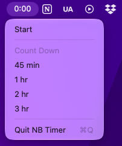

# NB Timer

A lightweight macOS menu bar stopwatch. The elapsed time lives in the menu bar (no Dock icon). Click the time to start, pause, resume, reset, or quit. Your session survives app restarts and the display sleeping.



## Requirements

- macOS (built with Xcode)
- [Xcode](https://developer.apple.com/xcode/) to build from source

## Build and install locally

From the repository root:

```bash
./scripts/rebuild.sh
```

The script:

1. Regenerates the app icon from `NB Timer/Icon/AppIcon.svg`
2. Builds a Release build with `xcodebuild`
3. Signs the app with your local Apple Development identity (if available)
4. Installs `NB Timer.app` to `~/Applications` and launches it

You can also open `NB Timer.xcodeproj` in Xcode and run the **NB Timer** scheme.

## Usage

| Action | How |
|--------|-----|
| Open controls | Click the time in the menu bar |
| Start | Choose **Start** |
| Count down | Choose **45 min**, **1 hr**, **2 hr**, or **3 hr** under **Count Down** (beeps and resets at zero) |
| Pause / resume | **Pause** or **Resume** |
| Reset | **Reset** |
| Quit | **Quit NB Timer** (or ⌘Q from the menu) |

The app registers for launch at login on first run (via `SMAppService`).

## Project layout

| Path | Purpose |
|------|---------|
| `NB Timer/NBTimerApp.swift` | App entry point and menu bar logic |
| `NB Timer/Localizable.xcstrings` | Menu strings (English, Indonesian) |
| `scripts/rebuild.sh` | Icon, build, install |
| `scripts/make-app-icon.sh` | SVG → asset catalog icons |

## License

MIT — see [LICENSE](LICENSE).